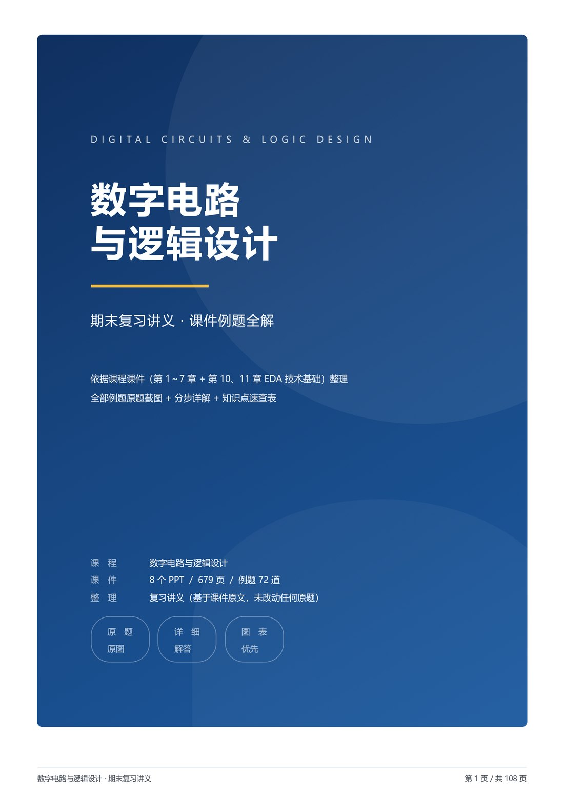
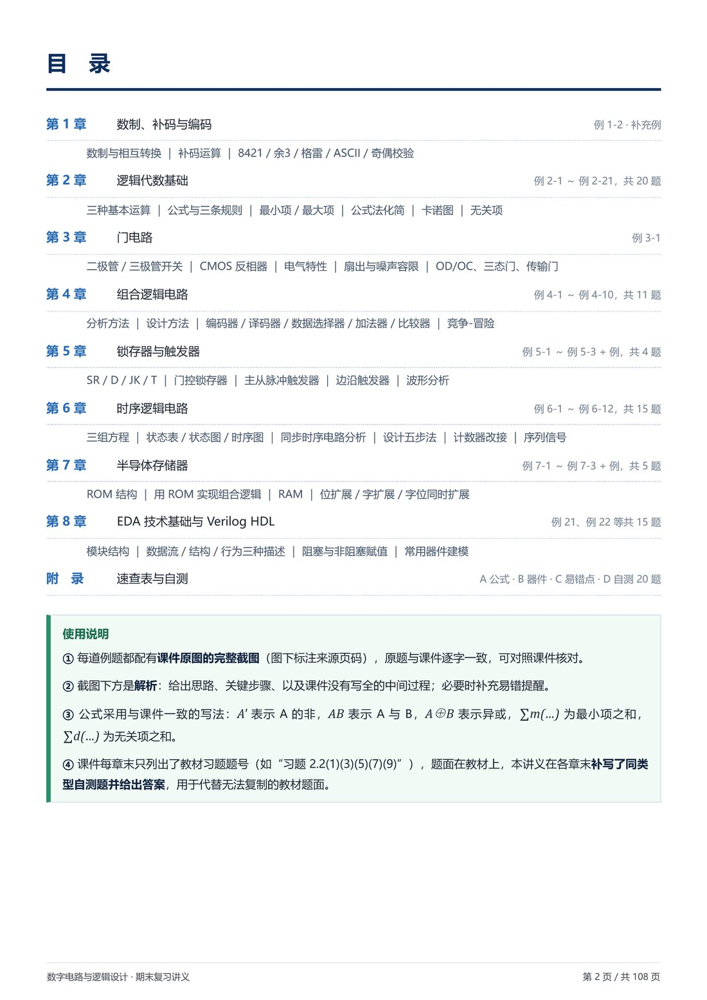
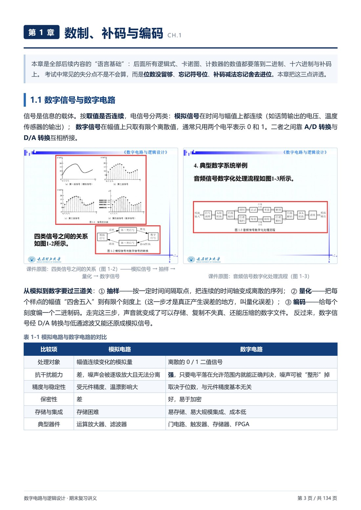
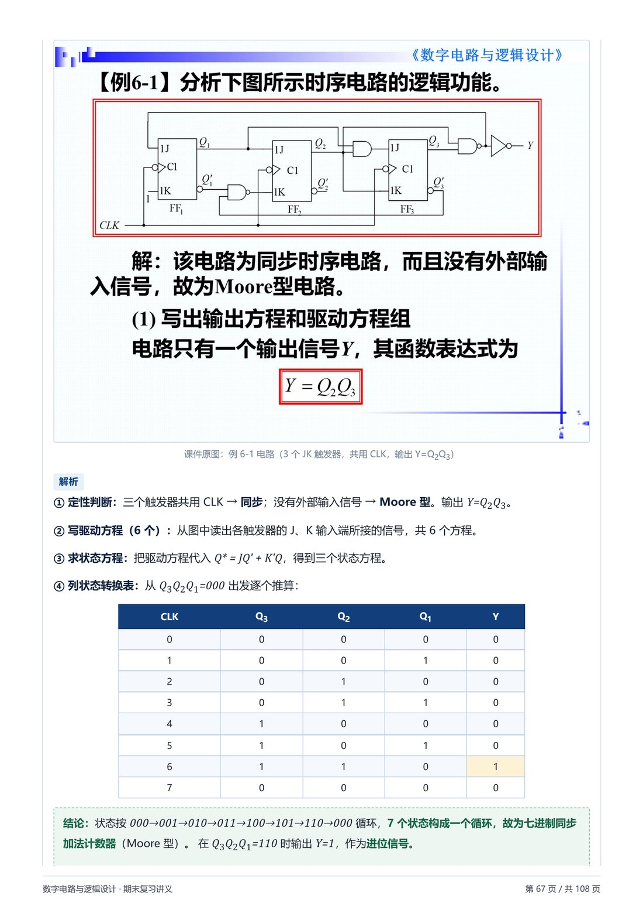
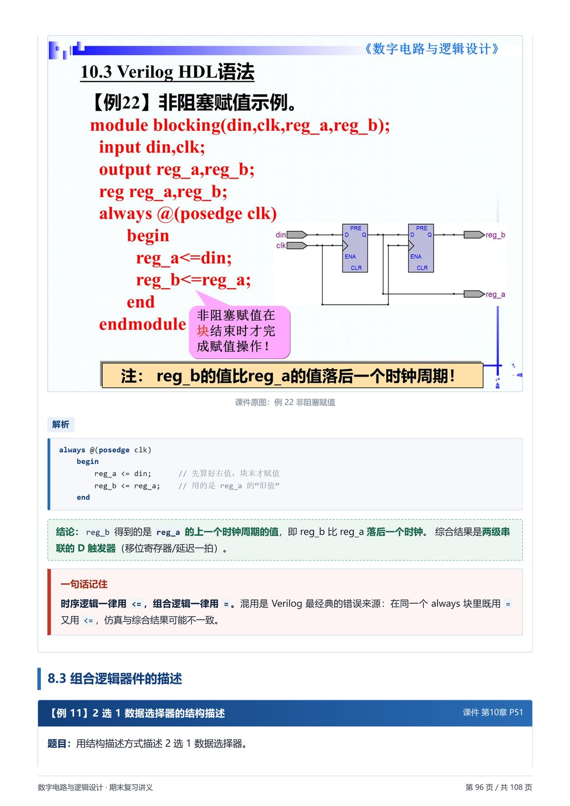

# PPT → Review PDF · a DeepSeek Harness skill

**Turn a folder of courseware slides (`.ppt` / `.pptx`) into a print-ready revision handout PDF — with the original slide screenshots embedded, every worked example re-typed and explained step by step, and tables/figures preferred over prose.**


---

## Why

Courseware is a terrible revision format. Lecture decks spread a single worked example across six slides (state diagram → K-map → drive equations → logic diagram), bury the answer in a screenshot of the textbook, and mix three embedded fonts per page. Students end up screenshotting 679 slides into a folder and scrolling.

This skill does what a good TA would do:

- read **every** slide of **every** deck,
- pull out **every** exercise and worked example,
- keep the **original slide as an image** (circuit diagrams must not be re-drawn by an LLM),
- and write the missing reasoning underneath it.

Reference run: **8 decks · 679 slides → 134-page PDF · 117 embedded slide screenshots · 72 examples fully solved · 21 MB.**

## What the output looks like

| | |
|---|---|
|  |  |
| **Cover and contents** — chapter list, example counts, per-topic keywords | **Contents detail** — what each chapter covers, how many examples it carries |



**Knowledge sections are first-class citizens.** Every deck section gets its own subsection with 2–4 paragraphs of explanation, its own courseware figure (here: the four signal classes and the audio digitisation chain), and a comparison table underneath. The rule is that the knowledge part alone must be readable without jumping into the examples.



**A typical example page.** Top half is the *untouched* courseware slide (circuit + the author's own solution). Bottom half is the added value: what to look at, the four analysis steps, a state-transition table generated from those steps, and a boxed conclusion that states the answer in one sentence.



**Code slides work the same way.** The original slide stays legible, the code is re-typed in a readable monospace block, and the difference between blocking and non-blocking assignment is spelled out — plus the one-line rule to remember it.

## Pipeline

```
 .ppt / .pptx ──► ppt2png.ps1 ──► .pptx + 679 PNGs
                                     │
                                     ├── extract.py ──► per-slide JSON/txt + index.txt
                                     │                        │
                                     │                        └──► locate every 例/习题
                                     │
                                     └── prep_img.py ──► print-ready JPEGs
                                                              │
   catalogues, tables, SVG ──► hand-authored HTML chapters ───┤
                                                              ▼
                                              print_pdf.mjs (Chrome + CDP)
                                                              │
                                                              ▼
                                                    A4 PDF, page numbers
                                                              │
                                              pdf2png.ps1 ──► visual QA
```

| Stage | Script | What it guarantees |
|---|---|---|
| Convert & export | `scripts/ppt2png.ps1` | Uses **PowerPoint COM** (`SaveAs 24`) for maximum fidelity — LibreOffice only as fallback. Exports every slide at 1600×1200. |
| Extract | `scripts/extract.py` | Recurses into grouped shapes, reads tables and speaker notes, emits `index.txt` (one line per slide, with `P`/`T` flags) for triage. |
| Locate questions | *(agent judgement over `index.txt`)* | Regex first (`例 / 习题 / 画出 / 化简 / 设计 …`), then **visual confirmation** on formula-heavy slides. |
| Prepare images | `scripts/prep_img.py` | White-point stretch flattens the deck's grid texture to pure white: 400 KB → ~150 KB per slide, and it prints cleaner. |
| Lay out | `assets/print.css` | A4, Chinese type scale, example cards, striped tables, callout boxes — the whole verified design. |
| Render PDF | `scripts/print_pdf.mjs` | Concatenates chapter fragments and prints through the **Chrome DevTools Protocol** — the only way to get a real `page X of Y` footer. |
| QA | `scripts/pdf2png.ps1` | Rasterises pages with WinRT `Windows.Data.Pdf` — no poppler, no ghostscript, no ImageMagick needed. |

## Quick start

Requires Windows with Microsoft PowerPoint, Chrome or Edge, Python 3 with `python-pptx` and `Pillow`.

```powershell
# 0. clone into your DSH skills root (optional — you can also just run the scripts)
git clone https://github.com/zhaokunpengtyut-pixel/reviewhelpper_ppt_to_pdf_skill.git `
  "$env:USERPROFILE\.dsh\skills\reviewhelpper_ppt_to_pdf_skill"

# 1. convert + export every slide
powershell -ExecutionPolicy Bypass -File scripts\ppt2png.ps1 -InputDir "D:\course\digital-circuits"

# 2. extract text, build the slide index
python scripts\extract.py --pptx "D:\course\digital-circuits\_pptx" --out "D:\course\digital-circuits\_text"

# 3. convert only the slides you will embed
python scripts\prep_img.py --slides "D:\course\digital-circuits\_slides" `
       --out ".\_src\img" --sel ch02:022 ch03:031 ch03:038 ch03:072

# 4. write chapters as 00_front.html, 01_ch1.html … + style.css, then print
node scripts\print_pdf.mjs ".\_src" ".\revision-notes.pdf" "Digital Circuits · Revision Notes"

# 5. visual QA
powershell -ExecutionPolicy Bypass -File scripts\pdf2png.ps1 ".\revision-notes.pdf" ".\_prev" 200
```

## Repository layout

```
.
├── SKILL.md                 # skill instructions (English)
├── SKILL.zh-CN.md           # original Chinese version
├── README.md
├── LICENSE                  # MIT
├── assets/print.css         # verified print stylesheet
├── docs/                    # README screenshots
└── scripts/
    ├── ppt2png.ps1          # .ppt → .pptx + per-slide PNG (PowerPoint COM)
    ├── extract.py           # python-pptx → JSON / txt / index.txt
    ├── prep_img.py          # slide PNG → print-ready JPEG
    ├── print_pdf.mjs        # HTML fragments → A4 PDF via Chrome CDP
    └── pdf2png.ps1          # PDF → PNG pages via WinRT (for QA)
```

## Rules baked into the skill

These are the defaults the skill applies without being asked, because they are what the requester actually wants:

1. **Every exercise is reproduced**, with a detailed, step-by-step answer. Where the courseware gives only the final result, the missing derivation is supplied. Where it gives only a problem number, an equivalent self-test with answer is written instead.
2. **Figures and tables beat prose.** Truth tables, K-maps, state-transition tables, comparison tables, flow diagrams — a paragraph explaining a circuit is a failure.
3. **The original slide is embedded as an image**, captioned with its source page. Circuit diagrams, waveforms and timing charts are never re-drawn by hand.
4. **The author's answers are re-checked.** The reference run surfaced two genuine errors in the courseware; both are flagged in the handout with the corrected value.

## Pitfalls the scripts already handle

| Pitfall | Handling |
|---|---|
| `position: fixed` footers and negative-margin bleed break in Chrome print | Page numbers come from the CDP `footerTemplate`; the cover is a contained card, not a full-bleed page |
| `break-inside: avoid` on big cards leaves near-empty pages | Cards may split; only headers get `break-after: avoid`, and tables/figures/`<pre>` get `break-inside: avoid` |
| Justified Chinese text stretches headings into `扩 展 题 三 步 速 算 法` | `text-align: left` forced on all headings and callout titles |
| PowerShell 5.1 reads `.ps1` as ANSI → Chinese paths fail | Scripts are ASCII-only and take paths as parameters |
| GBK console mangles Chinese analysis output | Everything is written to UTF-8 files and read back as files |
| A wrong `` fails silently in the PDF | QA step greps every `src` in the HTML and checks it exists on disk |
| PNG slides bloat the PDF | White-point stretch + 1200 px + JPEG q80 ⇒ ~11 MB of images |

## Language

The pipeline is language-agnostic. `SKILL.md` is in English; `SKILL.zh-CN.md` keeps the original Chinese wording, which is what the reference run was written against (Chinese courseware, Chinese handwriting). The generated handout inherits the language of the source slides.

## License

MIT — see [LICENSE](LICENSE).
